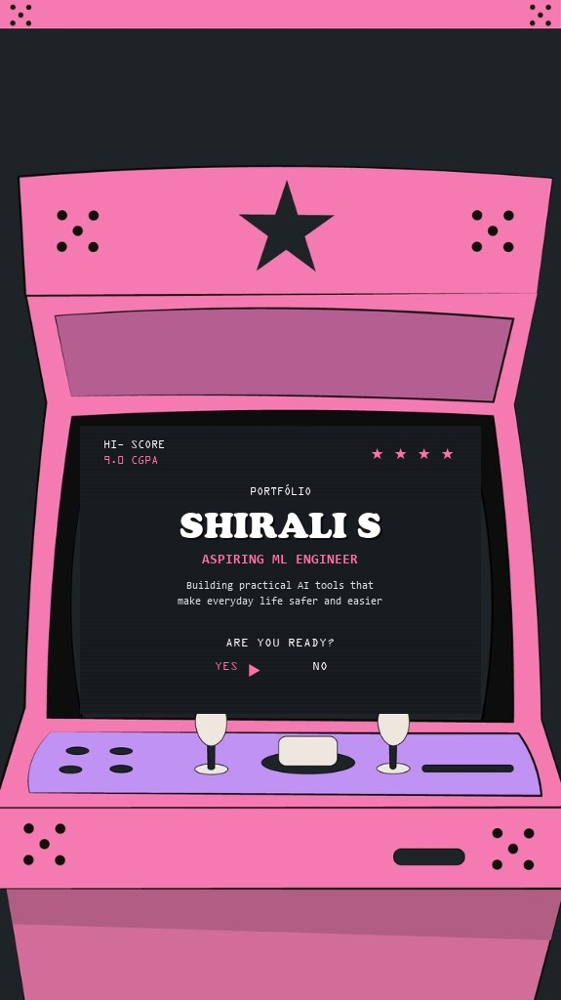

# 🕹️ Shirali S — Developer Portfolio & Arcade Experience

An interactive retro arcade portfolio crafted for **Shirali S**, Aspiring Machine Learning Engineer & Student Developer.



## 🌟 Highlights

- **Retro Arcade Cabinet Hero Section:**
  - Interactive CRT screen with scanlines, glow, and flicker.
  - Interactive joysticks and action buttons (A, B, C) with built-in synthesized 8-bit sound effects via the **Web Audio API** (no external mp3 files required!).
  - Working **"INSERT COIN"** coin slot with live credit counter and sound effects.
  - Interactive **"ARE YOU READY? [YES ▶] [NO]"** controls that launch a hyperspace scroll to the portfolio projects.
- **Flagship Projects Showcase:**
  - **PRISM AI : Multi Agent AI Research System** (Multi-agent research pipeline, multi-PDF document analysis, automated quality and bias scorecard, Streamlit web app, API key management, 1-click PDF export).
  - **Watch How Global Currencies Move** (Forex tick noise cleaning, market signal extraction, live visual indicators).
  - **The Digital Divide Dashboard** (Interactive World Bank socio-economic visual narrative).
  - **Student Record System (C & HTML)** (Modular C backend with algorithms, file persistence, and automated responsive HTML/CSS dashboard generation).
- **Comprehensive Resume Integration:**
  - **Education:** IIT Roorkee Minor in AI (2026-2027) & GSSSIETW B.E. Computer Science (2025-2029, CGPA: 9.0/10).
  - **Skills Matrix:** Python, C, HTML/CSS, Java, Inference Engineering, Multi-Agent Systems, Cybersecurity & Ethical Hacking, Git, Streamlit, Antigravity.
  - **Experience & Involvements:** Deloitte Australia Technology Job Simulation, Student Placement Coordinator, Joint Secretary (Adventure Club), Vice President (Heritage Club).
  - **Certifications:** Infosys Springboard (5x credentials), Cisco Networking Academy (Cybersecurity), VaultofCodes (Ethical Hacking), Computer Paradise (C Programming).
- **Retro Terminal Easter Egg:**
  - Fully interactive command-line terminal emulator supporting commands like `help`, `skills`, `projects`, `edu`, `contact`, `bio`, `matrix`, `clear`.
- **Contact & Transmission Form:**
  - Instant direct dispatch with sound effects, toast notification, and email fallback.

---

## 🚀 How to Run & Preview Locally

You can open `index.html` directly in any web browser!

Or, run a local development server using Python:

```powershell
cd "C:\Users\Shirali S\.gemini\antigravity\scratch\shirali-portfolio"
python -m http.server 8000
```

Then visit: [http://localhost:8000](http://localhost:8000)

---

## 🌐 Deploying to GitHub Pages or Vercel

### Option 1: GitHub Pages
1. Create a repository on GitHub named `portfolio` or `<your-username>.github.io`.
2. Push all files from this directory to the repository.
3. In GitHub repo settings, go to **Pages** > **Branch: main** > **Save**.
4. Your portfolio will be live at `https://<your-username>.github.io`!

### Option 2: Vercel or Netlify
1. Drag and drop this folder onto [Vercel](https://vercel.com) or [Netlify](https://netlify.com) for instant deployment with a free custom SSL domain.

---

## 🎨 Asset Structure

```
shirali-portfolio/
├── index.html        # Main HTML5 structure & retro arcade stage
├── styles.css        # Arcade styling, CRT effects, responsive grid
├── script.js         # Web Audio synthesizer, arcade mechanics, CLI terminal
├── assets/
│   └── shirali_arcade.jpg # High-resolution customized arcade graphic
└── README.md         # Documentation
```
